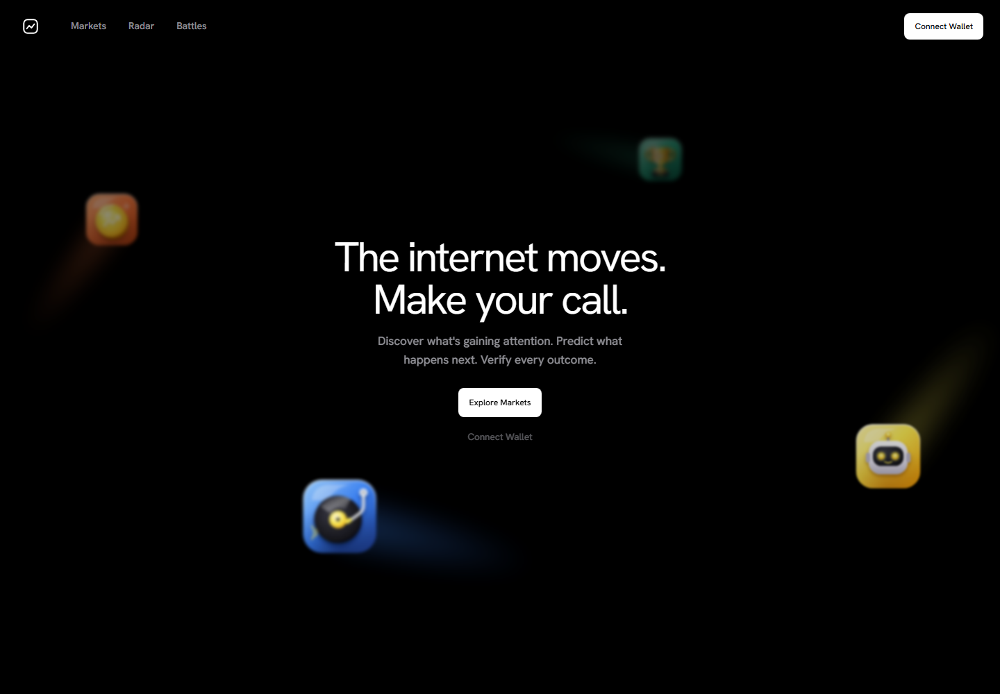
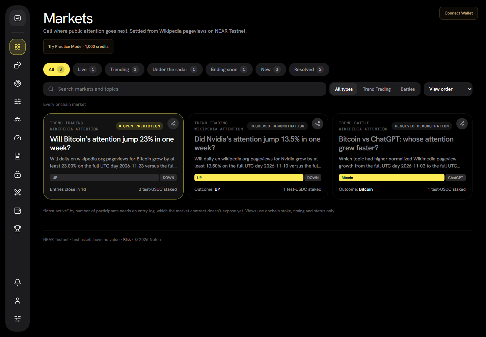
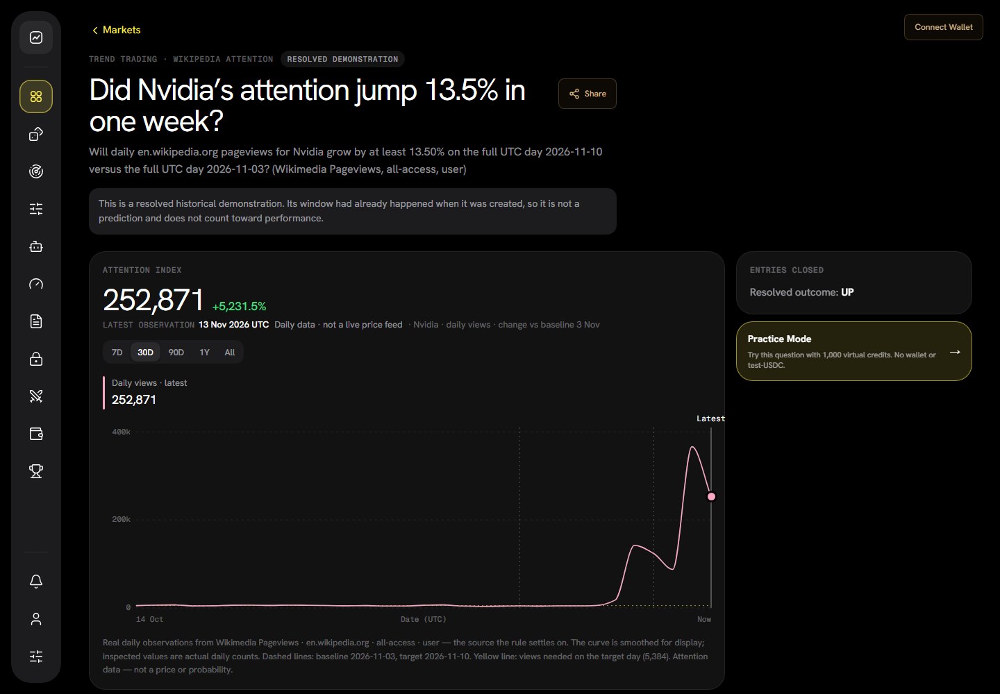
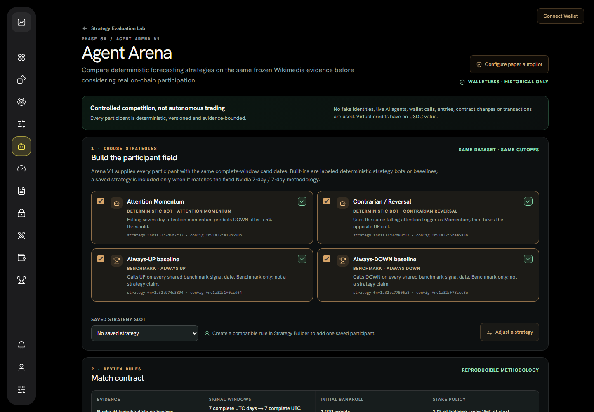
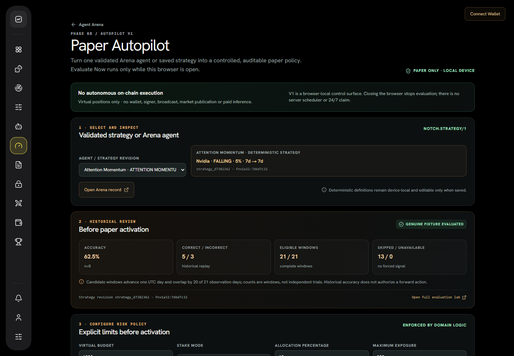
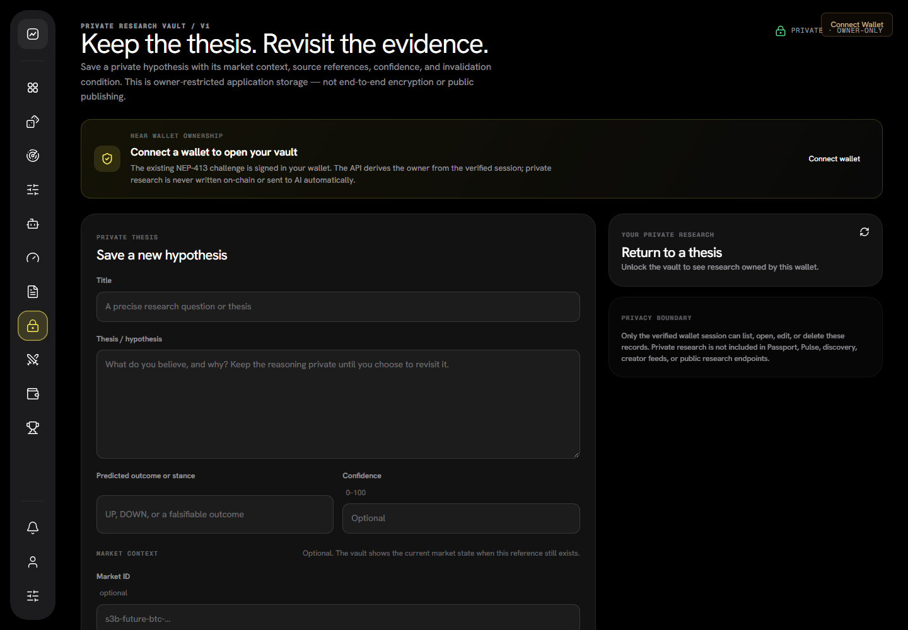
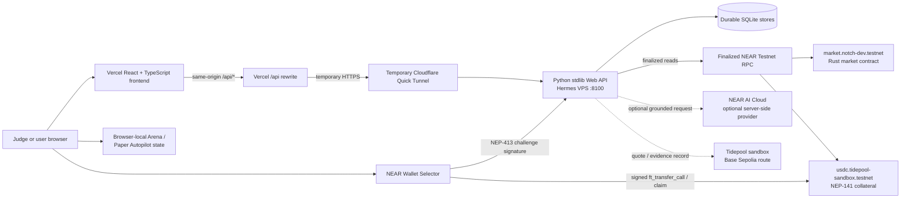

<p align="center">
  
</p>

<h1 align="center">Notch</h1>

<p align="center">
  <strong>Prediction intelligence with a paper trail. Built on NEAR.</strong><br>
  Turn public attention into explicit, source-backed forecasts, testnet positions and verifiable outcomes.
</p>

<p align="center">
  <a href="https://notch-blond-psi.vercel.app"></a>
  <a href="https://testnet.nearblocks.io/address/market.notch-dev.testnet"></a>
  <a href="contracts/market"></a>
  <a href="docs/JUDGE.md"></a>
</p>

<p align="center">
  <a href="https://notch-blond-psi.vercel.app">Open the live app</a> ·
  <a href="docs/JUDGE.md">Judge guide</a> ·
  <a href="docs/PROOF.md">Testnet proof ledger</a> ·
  <a href="docs/ARCHITECTURE.md">Architecture</a>
</p>

<p align="center">
  
</p>

> **Demo boundary:** Notch is a NEAR Testnet application. Test collateral has no monetary value. The live app is read-only until a user chooses to connect a wallet; no private keys or seed phrases are ever requested.

## Table of contents

- [The problem](#the-problem)
- [The solution](#the-solution)
- [Who it is for](#who-it-is-for)
- [Product tour](#product-tour)
- [Why NEAR](#why-near)
- [Built with](#built-with)
- [Architecture](#architecture)
- [On-chain proof](#on-chain-proof)
- [Routes](#routes)
- [API overview](#api-overview)
- [Try Notch](#try-notch)
- [Local development](#local-development)
- [Current limitations](#current-limitations)
- [License, author and hackathon](#license-author-and-hackathon)

## The problem

Prediction tools often stop at a score, a chart or an opinion. That leaves four practical gaps:

- **Signals without a paper trail.** A movement is interesting only when its source, observation window and rule can be inspected.
- **Credibility without context.** A forecaster's call is hard to evaluate when the original evidence, deadline and outcome are disconnected.
- **Research scattered across tools.** Notes, source references, market state and wallet history rarely live in one coherent workflow.
- **Decisions separated from outcomes.** It is easy to make a call and difficult to follow the exact rule through settlement, claims and verification.

Notch is built around the opposite standard: make the question explicit, preserve the evidence, expose the boundary between fact and interpretation, and let the chain carry the accounting truth.

## The solution

Notch turns a public attention signal into an inspectable prediction journey:

1. **Discover a movement.** Scout and Trend Radar surface source-backed Wikimedia attention changes.
2. **Investigate the rule.** A market names its source, UTC observation window, formula, threshold and invalidation policy.
3. **Form a forecast.** Research notes, evidence references and the Research Council help separate cited facts, interpretations and unknowns.
4. **Participate on NEAR Testnet.** A wallet signs a NEP-141 collateral entry into the deployed market contract.
5. **Track the call.** Finalized RPC reads feed positions, deadlines, claimability and Forecast Passport classifications.
6. **Verify the outcome.** Historical markets preserve evidence hashes, resolution transactions, claims and regression tests.

The surrounding surfaces make that journey usable without pretending every capability is autonomous or live:

| Surface | What is built | Boundary |
| --- | --- | --- |
| **Research Vault** | Wallet-owner-bound private theses with market context and references | Application authorization in SQLite; not end-to-end encryption |
| **Research Council** | Evidence-referenced bull, bear and verifier lenses with validation | Deployed backend has no `NEAR_AI_KEY`; deterministic fallback is labeled, not live inference |
| **Forecast Passport** | Pending/correct/incorrect/voided classification from finalized positions | A future market remains `PENDING` until legitimate resolution |
| **Agent Arena** | Reproducible strategy comparison over a frozen Wikimedia fixture | Deterministic and walletless; no live agent trading |
| **Paper Autopilot** | Browser-local policy, risk checks and audit rows | Paper-only; no signer, broadcast, market publication or token movement |

## Who it is for

- **Forecasters** who want a clear rule and a verifiable record instead of an unexplained signal.
- **Research-driven traders** who need to inspect source quality, deadlines and market state before deciding whether to participate.
- **Research creators** who want private working notes first, with an optional path to publish source-backed work.
- **Analysts and judges** who need to replay a prediction, inspect the chain state and distinguish a resolved demonstration from an unresolved forecast.

## Product tour

These screenshots were captured from the public deployment at [notch-blond-psi.vercel.app](https://notch-blond-psi.vercel.app) on 2026-11-14 UTC. They are rendered product screens, not mockups.

<table>
  <tr>
    <td width="50%"><br><sub><strong>Market explorer.</strong> One open future prediction sits beside two clearly labeled resolved demonstrations.</sub></td>
    <td width="50%"><br><sub><strong>Evidence and history.</strong> A resolved Nvidia replay shows its rule, outcome, source-backed attention curve and historical boundary.</sub></td>
  </tr>
  <tr>
    <td width="50%"><br><sub><strong>Agent Arena.</strong> Four deterministic participants use the same frozen evidence and cutoffs.</sub></td>
    <td width="50%"><br><sub><strong>Paper Autopilot.</strong> Historical review, explicit limits and paper-only execution boundaries are visible before activation.</sub></td>
  </tr>
  <tr>
    <td width="50%"><br><sub><strong>Private Research Vault.</strong> Owner-only application storage is explained before a wallet session is requested.</sub></td>
    <td width="50%"><br><sub><strong>Entry point.</strong> The live surface starts with discovery, markets and an explicit wallet boundary.</sub></td>
  </tr>
</table>

## Why NEAR

NEAR is not decorative infrastructure in Notch. It is the system of record for the parts that should not be rewritten by a browser or a research model:

- **Prediction-market contract:** `market.notch-dev.testnet` holds market configuration, escrow, positions, outcomes and claim/refund accounting.
- **NEP-141 collateral:** `usdc.tidepool-sandbox.testnet` is the six-decimal Testnet token used by the contract. One entry is `1,000,000` base units; it has no value.
- **Wallet-authorized participation:** Wallet Selector prepares a direct `ft_transfer_call` into the market contract. Notch never receives an exportable key.
- **Finalized reads:** The Python API reads market state, balances, positions and claimability from finalized NEAR RPC data.
- **NEP-413 owner authentication:** The Vault and creator surfaces use a signed challenge plus a final access-key lookup to derive the wallet owner of an application session.
- **Evidence-carrying settlement:** The resolver stores an evidence hash with the outcome; historical demonstrations include the full create → deposit → close → resolve → claim lifecycle.
- **Cross-chain testnet funding:** A completed Base Sepolia → NEAR Testnet Tidepool sandbox transfer is preserved as evidence. This is not a NEAR Mainnet or official NEAR Intents execution.

Notch does **not** claim NEAR Mainnet deployment, Chain Signatures, confidential-computing attestation, or autonomous execution.

## Built with

| Technology | Where we use it | Why it matters |
| --- | --- | --- |
| React 19 + TypeScript | `web/` product surface | Typed, route-based judge experience with explicit UI states |
| Vite + React Router | Frontend build, development proxy and routes | Fast local iteration and same-origin `/api/*` calls |
| Hanken Grotesk + Geist Mono | Frontend typography tokens | Preserves the established editorial / instrument-panel identity |
| NEAR Wallet Selector | Browser wallet connection and signed actions | Keeps signing in the user's wallet; no private keys enter Notch |
| Rust + `near-sdk` 5.30.1 | `contracts/market/` | On-chain market, escrow, resolution and claim/refund accounting |
| NEP-141 | Testnet collateral transfer path | Standard fungible-token settlement into the market contract |
| Python standard library | `services/web_api/` | Small server-side read/auth boundary without a stateful frontend backend dependency |
| Finalized NEAR RPC | `services/web_api/chain.py`, market reads | Positions, balances, deadlines and outcomes come from chain state |
| NEAR AI Cloud (optional) | Grounded briefs and Research Council | Context can be generated behind server credentials; validation and fallback prevent unsupported claims |
| SQLite | Funding, snapshots, radar, oracle, Vault, notifications and council stores | Durable local persistence behind the Hermes API; never Vercel filesystem storage |
| Tidepool Testnet sandbox | `services/intents/` | Base Sepolia → NEAR Testnet funding discovery and evidence capture |
| Vercel | Public React frontend | Hosts the built `web/` application |
| Hermes VPS | Python API and durable SQLite | Isolated user service bound to `127.0.0.1:8100` |
| Cloudflare Quick Tunnel | Temporary HTTPS ingress | Connects Vercel's `/api` rewrite to Hermes without changing DNS or existing tunnels |
| unittest, Cargo tests, Node tests, Oxlint and Chrome | Verification | Covers contract invariants, API boundaries, frontend behavior and public route smoke tests |

NEAR AI, Tidepool and the Quick Tunnel are integrated with explicit limitations. The deployed API currently has no `NEAR_AI_KEY`; the app returns truthful unavailable/fallback states rather than fabricating research.

## Architecture



**Responsibility split:**

- **On-chain:** contract configuration, market timing, escrow, positions, resolution status, evidence hash, claim/refund state and token transfers.
- **Wallet-authorized:** market entry, claim/refund and NEP-413 identity signing. The server prepares intent data or verifies a signature; it does not sign for the user.
- **Server-side:** finalized RPC reads, source/rule/evidence repositories, Research Council validation, Vault/notification sessions, funding records and durable snapshots.
- **Browser-local:** Arena selection, Paper Autopilot policy and paper audit rows. These are not chain state and do not authorize real actions.

The public backend currently uses the temporary Quick Tunnel hostname `sen-strictly-patches-brothers.trycloudflare.com`. It is deliberately not described as permanent production infrastructure; a restart may rotate the hostname and require a Vercel rewrite update. See the deeper component and lifecycle notes in [`docs/ARCHITECTURE.md`](docs/ARCHITECTURE.md).

## On-chain proof

The proof ledger separates what a transaction establishes from what it cannot establish. Start with [`docs/PROOF.md`](docs/PROOF.md) for verification notes and links.

| Claim | Network | Verifiable evidence | Meaning |
| --- | --- | --- | --- |
| Market contract deployed | NEAR Testnet | [`EFJvJ...`](https://testnet.nearblocks.io/txns/EFJvJVmBMWAh4Rqaxh7s2uCn72Hm1uXV3yc9zmEaEeDj) to `market.notch-dev.testnet` | Contract deployment and initialization; not a claim of Mainnet operation |
| Future market exists and is still open | NEAR Testnet | [`ALVPQ...`](https://testnet.nearblocks.io/txns/ALVPQpRCwngtpLPtG94SrXb9Y4jogaFToTzvGusveXDA), [live market API](https://notch-blond-psi.vercel.app/app/markets/s3b-future-btc-20261116-20261123) | A real open forecast with no outcome yet; not a resolved result |
| Historical resolution and claims | NEAR Testnet | Nvidia [`C4b882...`](https://testnet.nearblocks.io/txns/C4b882jAwpnZgo1ofHwAhQz55rFR7pjPyyGTMS1SD7pr), Battle [`C2sVEw...`](https://testnet.nearblocks.io/txns/C2sVEw9poAa9wqf4zGkkkXcrF1YxXw1yTPskBmoTntNU) | Settlement and stake recovery for one-sided historical replays; not profit |
| Base Sepolia → NEAR Testnet funding | Base Sepolia + NEAR Testnet | [source transfer](https://sepolia.basescan.org/tx/0x39623909068e564ad2304091dbe1477688e5e51f4e908674ff219f84217c2d7b), [refund](https://sepolia.basescan.org/tx/0x21acf175808d9c05b2b67dcee4b1dd18ebef0f73892037cd0411699b8145f49c), [NEAR settlement](https://testnet.nearblocks.io/txns/8b5WKmEqBpVu8mLDAbKHmrDHEiJCZEwBkHYqbryPKfum) | Finalized `1.047270` test-USDC destination delta plus `0.450000` excess refund; not market entry or payout |

The future Bitcoin market must remain **unresolved** until its legitimate resolution eligibility. Its current position is shown as `PENDING`; no future outcome or current-wallet claim is asserted.

## Routes

The frontend router is defined in [`web/src/main.tsx`](web/src/main.tsx). The main judge routes are:

| Route | Purpose | Authentication required | Current capability |
| --- | --- | --- | --- |
| `/` | Product landing page | No | Public live entry point |
| `/how-it-works` | Market rules, evidence and risk explanation | No | Public explainer |
| `/app/markets` | Market explorer | No | Three live Testnet markets: one future, two historical replays |
| `/app/markets/:id` | Market detail, chart, rule and outcome | No | Finalized chain state plus observed history where available |
| `/app/discover` | Scout and Pulse discovery | No | Source-backed / deterministic data with explicit coverage states |
| `/app/p/:accountId` | Forecast Passport | No for public account reads | Position classification; a connected wallet is not required to inspect a public account route |
| `/app/portfolio` | Wallet balances and positions | Wallet for connected-wallet view | Reads the selected account; does not simulate holdings |
| `/app/vault` | Private Research Vault | NEP-413 session to unlock records | Owner-only application storage; page explains the privacy boundary before signing |
| `/app/arena` | Deterministic strategy comparison | No | Walletless historical fixture evaluation |
| `/app/autopilot` | Paper policy and audits | No | Browser-local paper evaluation only |
| `/app/strategy-builder` | Create compatible strategy rules | No | Local strategy authoring for Arena / Lab |
| `/app/strategy-lab` | Replay a strategy against evidence | No | Historical evaluation with explicit evidence bounds |
| `/app/studio` | Creator research authoring and publishing | Wallet for owner actions | Public/read surfaces plus NEP-413-gated authoring |
| `/app/notifications` | Wallet-scoped deadline and settlement inbox | NEP-413 session | On-return reconciliation; no background worker |

Additional router paths include `/app/practice`, `/app/battles`, `/app/strategies` (Strategy Builder alias), `/app/radar`, `/app/leaderboard`, `/app/research/notes/:id`, `/app/research/plans/:id`, `/app/profile`, `/app/settings` and `/app/more`. Unknown paths redirect to `/`.

## API overview

The API returns JSON envelopes: successful reads generally use `{"data": ...}`; errors use `{"error":{"code":"...","message":"..."}}`. The frontend uses same-origin `/api/*` calls in production and keeps `VITE_API_BASE` empty.

| Group | Principal routes | Auth expectation |
| --- | --- | --- |
| Health and discovery | `GET /api/health`, `/api/briefs/status`, `/api/markets`, `/api/markets/:id`, `/api/markets/:id/history`, `/api/markets/:id/evidence`, `/api/trends`, `/api/scout`, `/api/pulse` | Public reads |
| Research | `GET /api/markets/:id/brief`, `GET /api/markets/:id/council`, `POST /api/markets/:id/research`, `POST /api/markets/:id/council` | Public research reads; provider may return unavailable/fallback states |
| Wallet reads | `GET /api/wallets/:accountId/balances`, `/positions` | Public chain reads for the requested account; no private key is accepted |
| Identity | `POST /api/research/identity/challenge`, `/verify`, `/revoke` | NEP-413 signed challenge; server returns a bearer session |
| Vault | `GET/POST /api/research/vault`, `GET /api/research/vault/:id`, `POST .../:id/update`, `POST .../:id/delete` | Verified bearer session; wrong or missing owner gets `401 AUTH_REQUIRED` / owner isolation |
| Notifications | `GET /api/notifications`, `POST /api/notifications/read/:id`, `/api/notifications/read-all` | Verified bearer session; V1 reconciles on authenticated return |
| Funding | `GET /api/funding/tokens`, `/readiness`, `/status/:quoteId`; `POST /api/funding/quote`, `/live-quote`, `/pre-transfer-balance`, `/deposit` | Server-side Tidepool configuration; user authorization is required before any live deposit flow |
| Market action preparation | `POST /api/markets/:id/entry-intent` | Returns a wallet action; does not sign or broadcast |

Common truthful failures include `AUTH_REQUIRED` (`401`), `MARKET_NOT_FOUND` (`404`), `HISTORY_UNAVAILABLE` (`503` when no recorder is configured), `COUNCIL_NOT_AVAILABLE`, `NEAR_AI_UNAVAILABLE` / `AI_UNAVAILABLE_FALLBACK`, `DEPENDENCY_UNAVAILABLE` and rate-limit responses. The authoritative field-level contract is [`docs/FRONTEND_INTEGRATION_CONTRACT.md`](docs/FRONTEND_INTEGRATION_CONTRACT.md).

## Try Notch

### No wallet needed

1. Open the [live app](https://notch-blond-psi.vercel.app).
2. Choose **Markets** and open the resolved Nvidia card. It is a historical replay, not a current forecast; inspect the Wikimedia chart, rule, outcome and evidence boundary.
3. Open the future Bitcoin market. It is a real open Testnet market with a locked question and deadline, but it has no outcome yet.
4. Open [Agent Arena](https://notch-blond-psi.vercel.app/app/arena), then [Paper Autopilot](https://notch-blond-psi.vercel.app/app/autopilot?agent=bot_attention_momentum_v1). The labels explain that the workflow is deterministic and paper-only.
5. Open the [Private Research Vault](https://notch-blond-psi.vercel.app/app/vault) to see the NEP-413 ownership requirement and the explicit non-encryption disclosure.

### With a NEAR Testnet wallet

- Use a NEAR Testnet account in a supported Wallet Selector wallet.
- Obtain only valueless Testnet NEAR and Tidepool Testnet collateral. Never enter a seed phrase or private key into Notch.
- Connect the wallet to inspect its finalized balances and positions. A new market entry requires enough NEAR for gas and registered `usdc.tidepool-sandbox.testnet` collateral.
- A wallet action opens a signing prompt. Review the receiver, method, market ID, outcome and amount before approving.
- The existing public proof already contains a future-wallet position. Judges do **not** need to repeat it, request a quote, transfer collateral, create a market, claim or resolve anything.

For a predictable read-only path, use [`docs/JUDGE.md`](docs/JUDGE.md). For a public account snapshot, the verified demo account's Passport route is [here](https://notch-blond-psi.vercel.app/app/p/4c9c0572fedb185055adb0acce14c2cf0f8652f07f3500fba7bacd3dadfad2c0); it shows a real `UP` position that remains `PENDING`.

## Local development

### Prerequisites

- Python 3.12+ (the services use the standard library runtime).
- Node.js 24+ and npm.
- Rust and Cargo if running the contract tests.
- A finalized NEAR Testnet RPC URL for live chain reads. The public default can be rate-limited; use a reliable archival endpoint when needed.

### Start the API and frontend

From the repository root:

```bash
# Keep values in a local, ignored .env file. Do not commit credentials.
copy .env.example .env        # Windows
# cp .env.example .env        # macOS/Linux

python -m services.web_api.cli --host 127.0.0.1 --port 8000
```

In a second terminal:

```bash
cd web
npm ci
npm run dev -- --host 127.0.0.1 --port 5173
```

Vite proxies `/api` to `http://127.0.0.1:8000` by default. Set `NOTCH_API` if the API uses another port. Keep `VITE_API_BASE` empty for same-origin API paths. Configure environment **names**, not production values, from [`.env.example`](.env.example); the frontend-only names are listed in the same section above.

### Verification commands

```bash
# Contract
cargo test -p notch-market

# Python services
python -m unittest discover -s services/trend_radar/tests -t .
python -m unittest discover -s services/oracle/tests -t .
python -m unittest discover -s services/intents/tests -t .
python -m unittest discover -s services/near_ai/tests -t .
python -m unittest discover -s services/web_api/tests -t .

# Frontend build and lint
cd web
npm run build
npm run lint
npm run test:research
npm run test:arena
npm run test:autopilot
npm run test:notifications
```

No `pytest` dependency is required; Python coverage is run with `unittest` in the current repository.

## Current limitations

- **NEAR Testnet only.** Test NEAR and Tidepool collateral have no monetary value.
- **AI is guarded.** The deployed backend has no `NEAR_AI_KEY`. Full live research generation is not a reliable demo path; source-only fallback and unavailable states are labeled. A model diagnostic does not prove TEE or confidential-computing attestation.
- **Paper means paper.** Arena and Autopilot never sign, broadcast, publish a market, transfer tokens or execute autonomous trading. Their audits are browser-local.
- **Vault is owner-restricted, not encrypted.** Records are application-authorized SQLite data; they are not end-to-end encrypted or anonymous.
- **Notifications are on-return.** V1 reconciles after an authenticated user returns; there is no continuous background worker.
- **Quick Tunnel is temporary.** The public API currently depends on a temporary Cloudflare hostname that can rotate on restart. It is not a permanent named production ingress.
- **The future market is not settled.** The Bitcoin forecast remains open/pending until its legitimate resolution eligibility. No current-wallet payout or profit is claimed.
- **Cross-chain funding is Testnet sandbox evidence.** The Base Sepolia → NEAR route proves a measured destination balance delta and refund, not Mainnet liquidity or official NEAR Intents execution.

## License, author and hackathon

- **Author / maintainer:** [Kaelah971](https://github.com/kaelah971), the GitHub owner of this repository.
- **Repository visibility:** private at the time of this documentation pass. The [live application](https://notch-blond-psi.vercel.app) is public; GitHub judges need repository access to inspect source and tests.
- **License:** no root `LICENSE` file is present. The Rust contract package declares `MIT` in [`contracts/market/Cargo.toml`](contracts/market/Cargo.toml); confirm repository-wide reuse terms before redistributing the full project.
- **Hackathon context:** the project brief targets **NEAR Hackathon 2026** and documents the **Unstoppable DeFi** and **Open Innovation** tracks. This README does not claim official track selection, sponsorship eligibility or an award.

The deeper records are intentionally separate from this overview:

- [`docs/JUDGE.md`](docs/JUDGE.md) — five-minute judge walkthrough.
- [`docs/ARCHITECTURE.md`](docs/ARCHITECTURE.md) — system boundaries and lifecycles.
- [`docs/PROOF.md`](docs/PROOF.md) — verified proof ledger and gaps.
- [`docs/PHASE_7D_CROSS_CHAIN_FUNDING.md`](docs/PHASE_7D_CROSS_CHAIN_FUNDING.md) — complete funding record.
- [`docs/S2_5_ONCHAIN_VERIFICATION.md`](docs/S2_5_ONCHAIN_VERIFICATION.md) — historical market lifecycle.
- [`docs/S5_NEAR_AI_VERIFICATION.md`](docs/S5_NEAR_AI_VERIFICATION.md) — AI validation and fallback contract.
- [`docs/AUTOPILOT_V1.md`](docs/AUTOPILOT_V1.md) — paper-only execution boundary.
