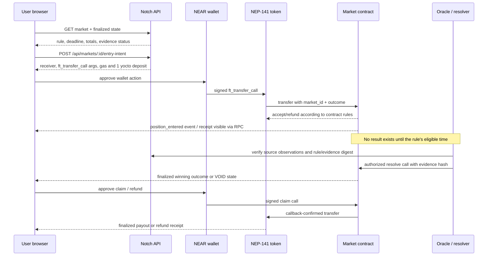

# Notch architecture

Notch is a split system: NEAR owns prediction-market accounting and finality;
Hermes owns read aggregation, evidence services and durable application state;
the browser owns presentation and explicitly bounded paper workflows.

- **Live frontend:** [notch-blond-psi.vercel.app](https://notch-blond-psi.vercel.app)
- **NEAR Testnet market:** [`market.notch-dev.testnet`](https://testnet.nearblocks.io/address/market.notch-dev.testnet)
- **Contract source:** [`contracts/market/`](../contracts/market/)
- **API contract:** [`FRONTEND_INTEGRATION_CONTRACT.md`](FRONTEND_INTEGRATION_CONTRACT.md)

## System map

```mermaid
flowchart TB
    subgraph Browser[User browser]
        UI[React + TypeScript + Vite]
        WS[NEAR Wallet Selector]
        Local[(localStorage<br/>notch.autopilot.v1)]
    end

    subgraph Edge[Public edge]
        V[Vercel static frontend]
        Rewrite[/api/:path* rewrite]
        CF[Cloudflare Quick Tunnel<br/>temporary hostname]
    end

    subgraph Hermes[Hermes VPS — claude-babe]
        API[Python stdlib Web API<br/>127.0.0.1:8100]
        SQLite[(Durable SQLite stores)]
        Identity[NEP-413 session verifier]
        Research[Grounding + Research Council]
        Funding[Tidepool adapter]
        Snapshot[Observed market snapshots]
    end

    subgraph Near[NEAR Testnet]
        RPC[Finalized RPC]
        Market[market.notch-dev.testnet<br/>Rust / near-sdk]
        Token[usdc.tidepool-sandbox.testnet<br/>NEP-141]
        Account[User accounts and access keys]
    end

    subgraph External[External sources]
        Wiki[Wikimedia Pageviews]
        AI[NEAR AI Cloud<br/>optional provider]
        Tidepool[Tidepool Testnet sandbox]
        Base[Base Sepolia USDC]
    end

    UI --> V
    UI -->|same-origin /api/*| Rewrite
    Rewrite --> CF --> API
    UI --> WS
    UI --> Local
    WS -->|signed entry / claim| Token
    WS -->|NEP-413 challenge signature| Identity
    Identity --> API
    API --> SQLite
    API --> Snapshot
    API --> Research
    API --> Funding
    API -->|finalized read calls| RPC
    RPC --> Market
    RPC --> Token
    RPC --> Account
    Research --> Wiki
    Research -. optional request .-> AI
    Funding --> Tidepool
    Base -->|user-authorized Testnet transfer| Tidepool
    Tidepool -->|settlement / refund evidence| Funding
```

### Deployment boundary

The current public path is:

```text
Browser
  → Vercel React static app
  → Vercel /api/:path* rewrite
  → temporary Cloudflare Quick Tunnel
  → Hermes user service at 127.0.0.1:8100
```

The Quick Tunnel is deliberately isolated from the existing Thence tunnels. It
has no DNS zone or stable named hostname and can rotate after a restart. The
rewrite currently points at the active temporary hostname. This is a demo
ingress, not a permanent production topology.

Hermes runs as `claude-babe` under a user-level systemd service with `Linger=yes`.
The API binds only to loopback; the tunnel is the only public ingress. SQLite
files live under a separate Notch data directory and were initialized fresh for
staging. No local Vault records, sessions or credentials were copied.

## Component responsibilities

| Component | Location | Responsibility | Authority |
| --- | --- | --- | --- |
| Browser UI | `web/src/` | Routes, charts, wallet prompts, research presentation and paper controls | Presentation and local paper state only |
| Wallet Selector | `web/src/wallet/` | Connect supported NEAR wallets and request signatures | User's wallet / access key |
| Web API | `services/web_api/` | JSON boundary, CORS, rate limits, finalized reads, auth-aware services | Server orchestration; never a wallet signer |
| Chain reader | `services/web_api/chain.py` and `services/intents/balance.py` | RPC reads for market, balances, positions and finality | NEAR finalized state |
| Market contract | `contracts/market/` | Market config, entry acceptance, escrow, resolution and claims/refunds | On-chain accounting truth |
| Oracle | `services/oracle/` | Frozen S3B rules, source receipts, evidence digests and resolution preparation | Evidence preparation; resolver still authorizes the write |
| Radar / Scout | `services/trend_radar/` | Wikimedia attention candidates and source references | Off-chain research input, not market truth |
| NEAR AI service | `services/near_ai/` | Optional grounded brief generation, model catalog and fallback | Context only; never payout authority |
| Research Council | `services/research_council/` | Cited fact/interpretation/unknown validation and disagreement summary | Evidence validation, not settlement |
| Creator / Vault | `services/creator_notes/` | NEP-413 sessions, owner-filtered private notes and public creator records | Server authorization bound to verified wallet |
| Funding adapter | `services/intents/` | Tidepool quote, manual deposit and observed Testnet settlement record | Testnet provider record; not Mainnet bridge authority |
| Snapshot store | `services/web_api/snapshots.py` | Sparse observed market history and heartbeat records | Observed API evidence; never interpolates missing history |
| Browser Arena / Autopilot | `web/src/arena/`, `web/src/autopilot/` | Deterministic fixture comparison, risk checks and paper audit rows | Local device only; not a scheduler or signer |

## Chain versus server

### On-chain

The NEAR contract stores and enforces:

- market mode, question, choices, source/rule metadata and timing;
- collateral token and minimum entry amount;
- per-account stakes and escrow totals;
- open, closed, resolved and void state;
- winning outcome and evidence hash supplied by the authorized resolver;
- pending, claimable and claimed accounting;
- callback-confirmed NEP-141 payout or void refund transfers.

The deployed collateral is `usdc.tidepool-sandbox.testnet`, a six-decimal
NEP-141 Testnet token with no value. The contract is not deployed to NEAR
Mainnet.

### Server-side

The API reads finalized chain data and combines it with off-chain records:

- market list/detail and finalized wallet balances/positions;
- source-backed radar candidates and historical snapshots;
- oracle rule/evidence records and research validation;
- NEP-413 sessions and owner-filtered Vault records;
- notification candidates reconciled from finalized positions;
- funding quotes, intent records and observed Base Sepolia / NEAR settlement;
- durable SQLite state for services that cannot use Vercel's ephemeral filesystem.

The server can prepare an entry intent, but the wallet signs the actual token
transfer. The server cannot claim a user's funds or move a user's tokens.

### Browser-local

Arena and Paper Autopilot use deterministic code and browser storage. The
`notch.autopilot.v1` record contains strategy identity, policy, evaluation and
audit rows for the local demo. It is intentionally not a remote execution queue.
Closing the browser stops evaluation. No wallet, signer, broadcast, market
publication, token transfer or autonomous scheduler is involved.

## Authentication boundaries

### Public reads

Market discovery, market detail, historical charts, public source references,
health, public creator notes/plans and requested public account reads do not
require a private session. They are still subject to API rate limits and
upstream availability.

### NEP-413 sessions

The creator/Vault identity flow is:

1. Browser requests a one-time challenge for a NEAR account.
2. The wallet signs the exact NEP-413 payload.
3. The server verifies the Ed25519 signature and performs a finalized access-key
   lookup for the account.
4. The server returns an expiring bearer session.
5. Owner-bound reads and writes derive the owner from that session, never from a
   client-supplied `account_id` alone.

The browser sends `Authorization: Bearer <session>` to protected API routes.
Missing or invalid sessions return `401 AUTH_REQUIRED`. A valid session for a
different account cannot enumerate another wallet's Vault records.

### Credentials

`NEAR_AI_KEY`, Tidepool credentials and any provider secrets remain server-side.
They are not compiled into Vite assets, returned in API payloads or written to
request logs. Wallet keys remain in the wallet provider.

## Market entry and settlement lifecycle



Important demo distinction:

- The two short-window historical markets completed this lifecycle and were
  claimed with one-sided 1-test-USDC stakes.
- The current future Bitcoin market is open with an `UP` position in the
  documented demo account, but it has not resolved and is not claimable.
- A historical claim demonstrates contract accounting and stake recovery, not
  trading profit.

## Research and agent pipeline

1. **Scout / Radar** records public Wikimedia observations and candidate source
   references.
2. **Rule builders** freeze the question, source identity, UTC windows, formula,
   threshold and invalidation policy. The canonical rule is hashed.
3. **Market detail** reads the rule, chain state and observed snapshots. A
   snapshot is recorded only when the API observes a change or hourly heartbeat;
   missing periods are not backfilled or interpolated.
4. **Research brief** optionally sends bounded, grounded context to NEAR AI from
   the server. Responses are normalized, cited and validated. When the key is
   absent or the provider fails, a source-only fallback is returned with an
   explicit status.
5. **Research Council** validates cited claims, counterpoints and unknowns across
   bull, bear and verifier lenses. It never writes market state.
6. **Arena** compares deterministic participants on the frozen Nvidia fixture.
7. **Paper Autopilot** applies local risk gates to the authoritative market
   response. A blocked or paper-executed row is an audit of the browser workflow,
   not a chain action.

See [`S3B_ORACLE_VERIFICATION.md`](S3B_ORACLE_VERIFICATION.md),
[`S5_NEAR_AI_VERIFICATION.md`](S5_NEAR_AI_VERIFICATION.md),
[`RESEARCH_COUNCIL_V1.md`](RESEARCH_COUNCIL_V1.md),
[`AGENT_ARENA_V1.md`](AGENT_ARENA_V1.md) and [`AUTOPILOT_V1.md`](AUTOPILOT_V1.md)
for implementation-specific contracts.

## Cross-chain funding pipeline

The implemented proof is a manually authorized Testnet route:

1. The API discovers supported funding routes and obtains a Tidepool quote.
2. The user reviews the route and, outside Notch's signer boundary, sends Base
   Sepolia test-USDC to the provider deposit address.
3. Tidepool settles the quoted amount into
   `usdc.tidepool-sandbox.testnet` for the NEAR Testnet recipient.
4. The provider refunds the excess deposit to the source wallet.
5. The API records intent IDs and independently compares a pre-transfer balance
   observation with a later finalized NEAR balance.

The preserved Phase 7D record measured `99.000000 → 100.047270` test-USDC on
NEAR, a `1.047270` delta, while `0.450000` test-USDC was refunded on Base
Sepolia. This is community-operated Testnet sandbox evidence, not official NEAR
Intents Mainnet execution and not proof that the funds paid for a particular
market entry.

See [`PHASE_7D_CROSS_CHAIN_FUNDING.md`](PHASE_7D_CROSS_CHAIN_FUNDING.md) and
[`PROOF.md`](PROOF.md).

## Persistence and data ownership

| Data | Owner / authority | Storage | Privacy / durability boundary |
| --- | --- | --- | --- |
| Market, position, outcome, claim | NEAR contract and finalized RPC | NEAR Testnet state | Public chain state |
| Rule and evidence receipt | Oracle / resolver process | Oracle SQLite + repository evidence | Server/operator evidence; hash may be written on-chain |
| Market history | API observation process | Snapshot SQLite | Sparse observed history; no interpolation |
| Vault theses | Verified wallet owner | Creator/Vault SQLite | Owner-filtered application storage; not encryption |
| Notifications | Verified wallet owner + finalized chain reads | Notifications SQLite | On-return reconciliation; no background worker |
| Funding records | User-authorized provider flow | Funding SQLite + evidence JSON | Testnet provider metadata; no private keys |
| Arena / Autopilot audits | Browser device | `localStorage` | Local paper state; not server authority |
| Frontend | Build output | Vercel | Static assets; no SQLite or server secrets |

## Local and production checks

From the repository root:

```bash
cargo test -p notch-market
python -m unittest discover -s services/web_api/tests -t .
cd web && npm ci && npm run build && npm run lint
```

The public showcase was also checked through the deployed Vercel alias with
headless Chrome screenshots for landing, markets, historical market detail,
Arena, Autopilot and Vault. Public API checks covered health, markets, history,
wallet positions, brief status and unauthenticated protected routes.
